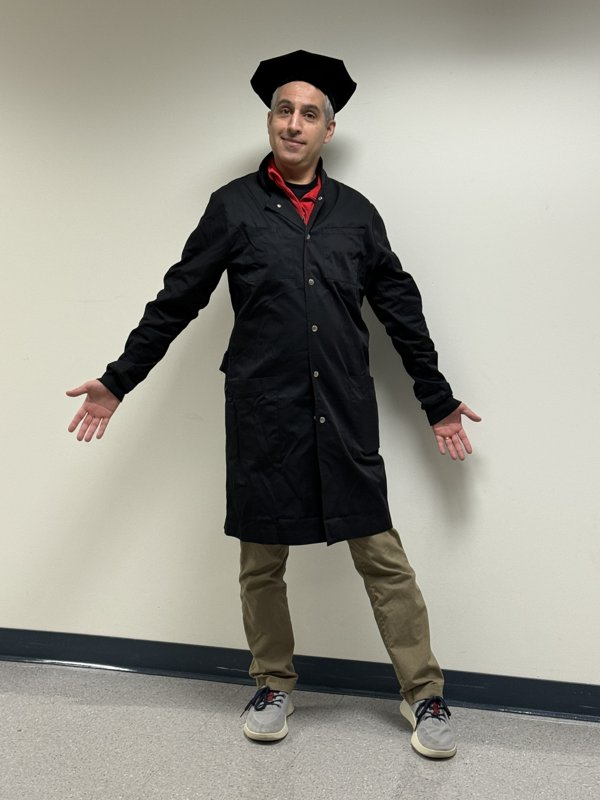

# About the Author {.unnumbered}

::: {.about-author}
::: {.about-photo}
{fig-alt="Carlos C. Goller wearing an academic cap and black robe" width=220}
:::

::: {.about-copy}
## Carlos C. Goller

Carlos C. Goller is the author of this workbook and is affiliated with the
Department of Biological Sciences at NC State University.

*LSC 170: Microbial Superheroes* introduces students to the C.R.E.A.T.E. method
for reading primary scientific literature. This workbook pairs that approach
with learning activities about *Delftia*, including guided reading, knowledge
checks, checklists, and space for notes.
:::
:::
